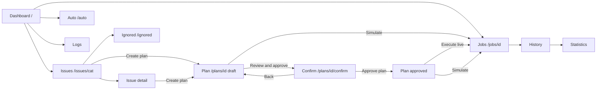
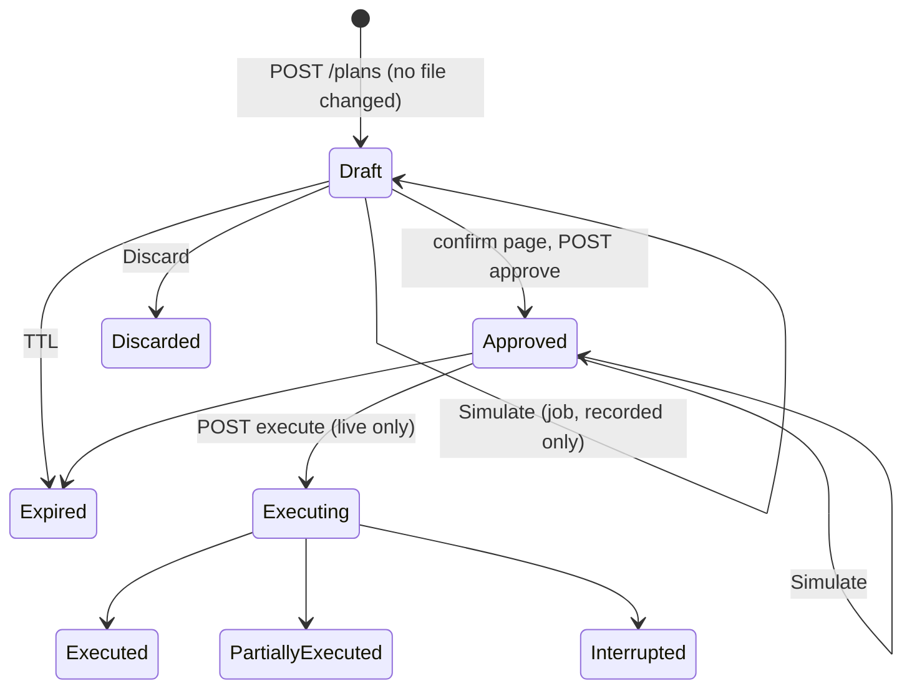
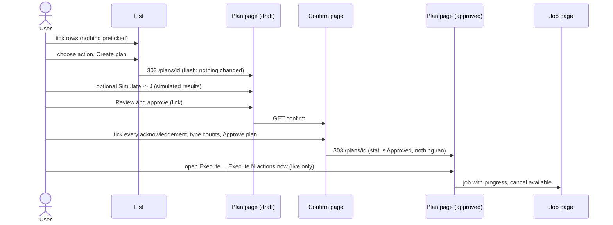

# Wireflows

Companion to `docs/ux-spec.md`. ASCII wireframes at 360 px and Mermaid flows. Text in wireframes stands for translation keys.
Glyphs: `(v)` check circle, `/!\` triangle, `(x)` octagon, `(i)` info circle.

## 1. Navigation map



## 2. Mobile shell

```
+----------------------------------+
| removarr   [Dry run]  [Last scan: 3 h ago (v)] |
+----------------------------------+
| (i) Dry run: nothing is changed  |
+----------------------------------+
| h1 Dashboard                     |
| ...content...                    |
+----------------------------------+
| Dash | Issues | History | Logs | More |   <- 56 px tab bar, current = underline + bold
+----------------------------------+
```

## 3. Dashboard (360 px)

```
+----------------------------------+
| (x) Action required              |  card, left border red
|  - Critical issues (3)           |
|  - Last scan is stale            |
+----------------------------------+
| Last scan   Nov 12 08:02 (3 h ago)  /!\ Stale |
| 12,431 scanned | 0 errors        |
| Next scheduled scan 11:00        |
| [ Scan now ]                     |
+----------------------------------+
| Potential space (estimate, not guaranteed)    |
|   41.3 GB   [estimate]           |
|   2.1 GB not counted: shared     |
| Space shared by hardlinks 310 GB |
| as observed by the last scan     |
+----------------------------------+
| Issues by category               |
| Permissions          3   (x) Critical |
| Junk files          12   /!\ Warning |
| Symlinks             0 (checked) (i)  |
| Ignored: 4  >                    |
+----------------------------------+
| Services                         |
| qBittorrent  (v) OK  v5.0   [Refresh] |
| Sonarr   (x) Unavailable [Refresh] [Rescan] |
| Radarr   Not configured          |
+----------------------------------+
| Automatic mode  (x) Paused  >    |
|  Reason: Critical issues         |
+----------------------------------+
```

## 4. Issue list (360 px)

```
h1 Junk files                  [Refresh]
Snapshot of the scan finished at 08:02
/!\ Only the first 1000 issues are listed.
[ Category: Junk files 12 /!\ v ]        <- details picker
Search [____________] [Search]
[ Filters (2 active) v ]
 chips: [Type: Folders x] [Recent items hidden x]
Showing 1 to 50 of 212 | Total size 41.3 GB
+--------------------------------------+
| [ ]  Some.Release.Name.2023.1080p    |
|      Folder - 3 torrents             |
|      4.2 GB | 12 days | /!\ Warning  |
|      [Blocked (2)]                   |
+--------------------------------------+
| [ ]  ...                             |
Pagination: [Previous]  Page 1 of 5  [Next]
(sticky) 0 selected | Nothing selected. Pick items to act on them.
         [Select all 50 items on this page]
         Action [Choose an action v]  [Create plan...] (aria-disabled)
```
After ticking two rows:
```
(sticky) 2 selected | 50 on this page | 212 in this list
         Selection total: 8.4 GB | 1 has blockers and will be excluded
         [Clear selection]  Action [Delete v]  [Create plan...]  [Ignore] 
```

## 5. Plan lifecycle



## 6. Destructive flow, step by step



Confirmation page (360 px):

```
h1 Confirm the plan                [Live]
Target
  media:/Movies/Old.Release.2019      
  torrents:/completed/x ...  
  [Show all 14 targets]
Delete: 14 items (3 folders, 11 files)
Actions            14
Space impact
  Logical size          41.3 GB
  Expected freed (prediction)   38.0 GB
  Added space           0 B
  Net (prediction)      38.0 GB
+--(x)---------------------------------+
| This cannot be undone                |
|  - Files are removed and cannot be recovered. |
|  - The torrent task is removed. qBittorrent keeps the data. |
+--------------------------------------+
Torrent tasks that will be removed (2)
  - Release.A (ab12cd34)
Samples to acknowledge (each one explicitly)
  [ ] media:/Movies/Old/sample.mkv
Old media files that cannot be recovered
  [ ] media:/Movies/Old/Old.2019.mkv
Type the number of actions to confirm  [______]
Type the number of torrent tasks to confirm [______]
Approving does not run anything. Execution is a separate step.
[ Back to the plan ]          [ Approve plan ]   <- Back first in focus, Approve last
```

## 7. Dry-run preview vs destructive confirmation

| Aspect | Preview / simulate | Confirmation |
|---|---|---|
| Banner | info "Preview: nothing has been changed" | red "This cannot be undone" panel |
| Style of buttons | outline (secondary) | danger (red) for Approve only |
| Inputs | none | acknowledgements (unchecked), typed counts (empty) |
| Effect | none, or recorded simulation | marks approved; runs nothing |
| Reachable from | list, detail, plan page | plan page link only |

## 8. Job and cancellation

```
h1 Job: Execute plan          (i) Running
Stage: removing files          [=====>     ] 12 of 40
[ Cancel this job v ]   -> details: "The job stops at the next safe point. Work already done is kept."
                                    [ Yes, request cancellation ]
After: "Cancellation requested" -> terminal "Cancelled: 12 of 40 done; 28 not started."
```

## 9. Statistics (360 px)

```
h1 Statistics
[Measured freed space 38.0 GB]  [Added cost 0 B]  [Net 38.0 GB]
Potential: 41.3 GB [estimate]   Expected: 38.0 GB [predicted]   Observed: 31.2 GB [observed]
<svg chart, 4 lines: dash+marker+direct label>
Legend: -- potential (circle) | .. expected (square) | __ attributable (triangle) | -.- observed (diamond)
Snapshots (for example Btrfs) can keep space in use ...
> Space per day (cards on mobile / table >= 960)
```
